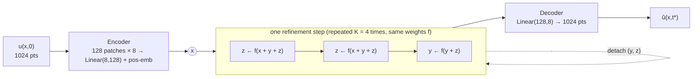
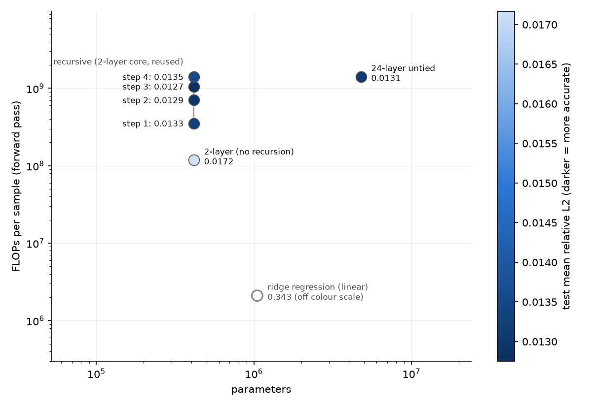

# Does thinking longer help a tiny network solve a PDE?

### TRM-style recursive refinement on PDEBench 1D Burgers, with controls for size and compute

> **Status.** Final. 2 seeds per model (mean ± sample std), plus a control that matches the number of
> optimizer updates. Two seeds give a rough spread, not confidence intervals.

**TL;DR.** On PDEBench 1D Burgers (ν = 0.01), predicting u(x, t=1) from u(x, 0):

* A 2-layer Transformer applied recursively (TRM-style, 12 core calls) reaches **0.0135 ± 0.0007** test relative L².
* A 24-layer untied Transformer with the **same computation** reaches **0.0131 ± 0.0006**. That is a tie, with
  11× more parameters.
* The **same 2-layer network applied once** looks worse (0.0172 ± 0.0026). **But given the same number of
  optimizer updates as the recursive model, it reaches 0.0112 ± 0.0017**, better than both, at 1/12 of the
  inference compute.
* Recursion's one consistent advantage is **RMSE**: 0.0073 ± 0.0003, against 0.0108–0.0129 for every other model,
  in both seeds.
* Refinement steps 1→3 improve the prediction, and step 4 makes it worse.

**We find no evidence that recursion improves the primary metric.** Its advantage over the same-size network
is explained by longer training, and it only ties untied depth. It may help on high-amplitude, shock-dominated
cases, which is what the RMSE result suggests; that needs a targeted test. All Transformers are about 25×
better than the best linear map, so the task is learnt and needs nonlinearity.

---

## 1. Motivation

### Why Burgers' equation?

The viscous Burgers equation

$$\partial_t u + \partial_x\!\left(\tfrac{u^2}{2}\right) = \tfrac{\nu}{\pi}\,\partial_{xx} u,\qquad x\in(0,1)\ \text{periodic}$$

is the simplest PDE that has both of the effects that make fluid dynamics hard:

* **Nonlinear advection** (u ∂ₓu): faster parts of the wave overtake slower parts, so smooth initial
  conditions **steepen into shocks**, i.e. near-discontinuities.
* **Diffusion** (ν ∂ₓₓu): smooths those fronts out, at a width set by ν.

It is the standard 1D model for gas dynamics, traffic flow and "Burgers turbulence", and the standard first test
for shock-capturing numerical schemes. For machine learning it is a useful stress test, because neural networks
are biased toward smooth, low-frequency functions, while Burgers solutions have **sharp, moving fronts whose
position depends nonlinearly on the whole initial condition**. A model that blurs or misplaces a shock gets a
large error. In 1D it is also cheap enough to run a controlled study with several models and seeds in one day
on two GPUs.

### Why recursion?

Classical PDE solvers are iterative: they take time steps, run Newton iterations, and do multigrid V-cycles. They
reach accuracy by **applying the same cheap update many times**, not by building a bigger operator. Recursive
neural models apply the same idea to learning: one small network is applied repeatedly to refine its own answer.

* **Tiny Recursive Models (TRM)** ([Jolicoeur-Martineau, 2025](https://arxiv.org/abs/2510.04871)) showed that a
  7M-parameter network that recursively refines a latent "reasoning" state z and an answer y reaches 45% on
  ARC-AGI-1. That beats far larger models, and "less is more" was the headline.
* Weight-tied depth has a long history: [Universal Transformers](https://arxiv.org/abs/1807.03819),
  [Deep Equilibrium Models](https://arxiv.org/abs/1909.01377), and in PDE learning
  [PDE-Refiner](https://arxiv.org/abs/2308.05732), which uses iterative refinement to fix the high-frequency
  errors of neural solvers.
* Recursion is attractive for scientific ML because it promises **solver-like accuracy from a parameter budget
  that fits on edge devices**, and **adjustable compute at inference time** (run more refinement steps when
  accuracy matters).

TRM's results come from **discrete puzzles with exact answers**, such as Sudoku, mazes and ARC. It is an open
question whether the same mechanism helps on a **continuous regression** problem with physical structure. That
is what we test, and we include the controls needed to separate "recursion helps" from "more compute helps".

### Why this dataset?

We use `1D_Burgers_Sols_Nu0.01.hdf5` from **PDEBench** ([Takamoto et al., NeurIPS 2022 Datasets & Benchmarks](https://arxiv.org/abs/2210.07182)):

| Reason | Detail |
|---|---|
| **A public, citable standard** | It has a fixed DOI ([doi:10.18419/darus-2986](https://doi.org/10.18419/darus-2986)), a fixed file, an MD5 checksum and published baselines, so anyone can rerun this study exactly. |
| **Large and high-resolution** | 10,000 trajectories × 1,024 grid points × 201 snapshots on t ∈ [0, 2]. That gives 8,000 training pairs, 8× the 1,000 used in the original FNO Burgers benchmark, and 1,000 test pairs, which keeps error bars tight. |
| **The right difficulty (ν = 0.01)** | PDEBench provides ν ∈ {0.001, 0.01, 0.1, 1.0}. The large-ν files are diffusion-dominated and smooth. ν = 0.001 is close to inviscid, with shocks thinner than the grid can resolve. At ν = 0.01 (effective viscosity ν/π ≈ 0.003) **shocks form but are still resolved at 1,024 points**, so the problem is genuinely nonlinear and still well-posed for a learnt model. Our ridge-regression baseline confirms the nonlinearity: the best linear map has 34% error. |
| **Fits the time budget** | One 8 GB file. The whole study (download, 3 models × 2 seeds, evaluation) fits in about 8 hours on 2×A100. |

The initial conditions are random superpositions of sine waves with random amplitudes and phases (PDEBench
Eq. 8), and boundaries are periodic.

---

## 2. Task and setup

**Task.** Learn the operator **u(x, 0) ↦ u(x, t\*)**, with t\* = 1.00. That is stored snapshot 100, midway
through the stored trajectory. We use one input/target pair per trajectory and all 1,024 grid points. Every
refinement step of the recursive model predicts the same t\*; the steps are *not* successive physical times.

| | |
|---|---|
| Split | 80/10/10 by trajectory (8,000 / 1,000 / 1,000), seed 42, made **before** any preprocessing |
| Normalization | One scalar mean and std (−0.0124, 0.7151) fitted on the training split only, then inverted before computing any metric |
| Metrics | **Mean per-trajectory relative L²**, ‖û − u‖₂ / ‖u‖₂ (primary), and RMSE in physical units |
| Selection | EMA weights (decay 0.999) chosen by best **validation** relative L². The test set is touched once, by `evaluate.py`. |
| Optimization | AdamW, lr 3·10⁻⁴, weight decay 0.01, gradient clipping 1.0, batch 64, BF16, 200-step warmup then cosine decay, **1,000 epochs for every model** (except the 4× control) |

### Models

All learned models share **the same patch encoder and decoder**. The 1,024-point field is cut into 128 patches of
8 points. A shared `Linear(8→128)` plus learned positional embeddings turns these into tokens, and a shared
`Linear(128→8)` turns tokens back into the field. The encoder and decoder are linear and act on each patch
separately, so **all mixing across space and all nonlinearity happen in the Transformer core**. The core is
made of pre-norm, non-causal Transformer layers (width 128, 4 heads, FFN ×4) with a final LayerNorm.



| Model | Core | Params | Layer applications per prediction | MFLOPs per sample | Role |
|---|---|---|---|---:|---|
| **Recursive (TRM-style)** | 2 layers, reused: n = 2 z-updates + 1 y-update per step, K = 4 steps | 415,624 | 4 × 3 × 2 = **24** | 1,410 | the method being tested |
| Shallow | 2 layers, applied once | 415,368 | 2 | 118 | **same parameter count** as recursive |
| Shallow, 4× epochs | as shallow, trained for 4,000 epochs (500k updates) | 415,368 | 2 | 118 | **same number of optimizer updates** as recursive |
| Deep | 24 untied layers, applied once | 4,777,352 | **24** | 1,410 | **same computation per prediction** as recursive |
| Ridge regression | linear map u(x,0) → u(x,t\*) with bias, α chosen on validation | 1,049,600 | – | 2.1 | does the task need nonlinearity? |
| Persistence | û = u(x,0) | 0 | – | 0 | does anything change over time? |
| Training-mean field | û = mean of the training targets | 1,024 | – | 0 | is the input used at all? |

FLOPs are computed from the architecture: matrix multiplies plus attention, 2 FLOPs per multiply-add, with
normalization and activations ignored. Each Transformer layer is 58.7 MFLOPs on 128 tokens at width 128.

**Recursive training follows TRM deep supervision.** For each of the 4 steps we:

1. re-encode the input with the current weights;
2. run the step's 3 core calls;
3. decode and take the MSE against the target;
4. back-propagate through those 3 calls and take an AdamW step;
5. detach (y, z) before the next step.

The learned initial y₀ and z₀ are vectors broadcast over all patches. This is a simplified, continuous-output TRM
(n = 2, T = 1, K = 4) with no learned halting.

---

## 3. Results

### 3.1 Main table (test set, n = 1,000; mean ± std over 2 seeds)

| Model | Params | MFLOPs/sample | Val rel L² | **Test rel L²** | Test RMSE | Latency, batch 1 (ms) | Latency, batch 1000 (ms) | Train time, seed 0 (min) | Optimizer steps |
|---|---:|---:|---:|---:|---:|---:|---:|---:|---:|
| Training-mean field | 1,024 | 0 | 0.9999 | 1.0047 | 0.6026 | – | – | – | – |
| Persistence u(x,0) | 0 | 0 | – | 1.7669 | 0.5237 | – | – | – | – |
| Ridge regression | 1,049,600 | 2.1 | 0.3592 | 0.3434 | 0.1335 | – | – | – | – |
| Shallow (2-layer) | 415,368 | 118 | 0.0174 ± 0.0028 | 0.0172 ± 0.0026 | 0.0113 ± 0.0019 | **1.15** | **4.36** | **17.0** | 125k |
| **Shallow, 4× epochs** | 415,368 | 118 | **0.0116 ± 0.0019** | **0.0112 ± 0.0017** | 0.0108 ± 0.0022 | **1.16** | 4.62 | 53.0\* | 500k |
| Recursive (TRM-style) | 415,624 | 1,410 | 0.0131 ± 0.0008 | 0.0135 ± 0.0007 | **0.0073 ± 0.0003** | 8.66 | 50.02 | 141.5 | 500k |
| Deep (24-layer untied) | 4,777,352 | 1,410 | 0.0131 ± 0.0006 | 0.0131 ± 0.0006 | 0.0129 ± 0.0029 | 10.41 | 44.78 | 112.5 | 125k |

Latency is the median of 50 BF16 forward passes on an A100-SXM4-80GB. Training times are from seed 0, which
ran alone on its GPU. Seed-1 runs shared a GPU with another job, so their times are inflated. \*The 4× control
shared its GPU with another training job the whole time. Even so, its pace (0.8 s/epoch) was no slower than
the solo shallow run (1.0 s/epoch).

**Per-seed test relative L².** Shallow 0.0153 / 0.0190. Shallow 4× 0.0100 / 0.0124. Recursive 0.0140 / 0.0131.
Deep 0.0126 / 0.0135. **Both seeds of the 4× shallow model beat both recursive seeds.** The recursive and deep
seeds overlap. On RMSE, both recursive seeds (0.0075 / 0.0071) beat every seed of every other model.



*Each model placed by parameter count (x) and forward-pass FLOPs per sample (y), coloured by test relative L²
(darker = more accurate, mean over seeds). The recursive model's 4 refinement steps form a vertical column: same
parameters, more compute. Ridge regression is drawn hollow and kept off the colour scale, since its error is
about 25× higher. Moving **up** (recursion, 12× the FLOPs) and moving **up and right** (untied depth, 12× the
FLOPs and 11× the parameters) reach about the same error. Not shown: the 4×-epoch shallow model sits at the
shallow model's position (same parameters and FLOPs) and is more accurate than every point on this plot.
Inference compute is not what limits the small model; training length is.*


*Left: test relative L² after each refinement step of the recursive model. The horizontal lines are the shallow
and deep controls. Persistence and ridge regression are left out because they are 20–100× worse; they are in
the table. Right: the same errors plotted against measured inference latency at batch 1000.*

### 3.2 Recursive model after each refinement step (same checkpoint, mean ± std over 2 seeds)

| Step | Layer apps | MFLOPs/sample | Test rel L² | Test RMSE | Latency, batch 1 (ms) | Latency, batch 1000 (ms) |
|---|---:|---:|---:|---:|---:|---:|
| 1 | 6 | 353 | 0.0133 ± 0.0005 | 0.0084 ± 0.0002 | 2.54 | 12.68 |
| 2 | 12 | 705 | 0.0129 ± 0.0008 | 0.0076 ± 0.0002 | 4.57 | 25.15 |
| 3 | 18 | 1,058 | **0.0128 ± 0.0007** | **0.0073 ± 0.0003** | 6.62 | 37.60 |
| 4 (reported) | 24 | 1,410 | 0.0135 ± 0.0007 | 0.0073 ± 0.0003 | 8.66 | 50.02 |


*|û − u| along x after each refinement step, for test trajectories at the 10th, 50th and 90th percentile of the
recursive model's error. The error at the shocks (x ≈ 0.95 in the middle panel; x ≈ 0.48 and 0.9 on the right)
hardly changes across steps. In these examples, step 4's extra error appears over the smooth ramps instead.*

### 3.3 Example predictions


*Top: u(x,0) (dashed), the true u(x,1) (black), and each model's prediction. Bottom: |error| on a log scale.
The three columns are the 10th, 50th and 90th percentile test trajectories by recursive-model error.*

What the examples show:

* **By t = 1 the solutions have formed shocks.** The median and 90th-percentile cases show the characteristic
  Burgers sawtooth: linear ramps ending in steep fronts. The 10th-percentile case is a low-amplitude wave that
  diffusion has kept smooth, with no shock.
* **The errors are at the shocks.** All three Transformers follow the ramps to about 10⁻³ and peak at
  10⁻²–10⁻¹ on the fronts, where a small error in the shock's position becomes a large pointwise error. The
  shallow model has the largest peaks at the shocks. The deep and recursive models are closer to each other.
* **Ridge regression predicts an almost flat line near the mean of u(x,0).** With periodic boundaries, Burgers
  conserves ∫u dx, so the spatial mean is the one thing a linear map can predict reliably. It cannot place a shock,
  which is why the best linear model's error stops at 0.34.

### 3.4 Context: results from other work

**None of these numbers is directly comparable to ours.** The datasets and protocols differ, and the differences
are listed in the table. They are included to show the scale of error that strong methods reach on Burgers.

| Source | Data | Task | Model | Error |
|---|---|---|---|---|
| PDEBench, Table 7 ([Takamoto et al., 2022](https://arxiv.org/abs/2210.07182)) | **Same file** (ν = 0.01) | Autoregressive rollout of the whole trajectory from 10 initial steps, downsampled 4× in space (256 pts) and 5× in time | FNO | nRMSE **0.0078** |
| | | | U-Net | nRMSE 0.22 |
| | | | PINN (fitted per sample) | nRMSE 0.85 |
| FNO paper, Table 3 ([Li et al., ICLR 2021](https://arxiv.org/abs/2010.08895)) | Own dataset: ν = 0.1 (more diffusive), Gaussian random field initial conditions, **1,000** training samples | **Same task form**: u(x,0) ↦ u(x,1), relative L², at 1,024 points | FNO | **0.0160** |
| | | | LNO / MGNO / GNO | 0.0217 / 0.0374 / 0.0651 |
| | | | PCA-NN / FCN | 0.0391 / 0.1877 |
| **This study** | PDEBench ν = 0.01, 8,000 train | u(x,0) ↦ u(x,1), relative L², at 1,024 points | Shallow / Recursive / Deep Transformer | 0.0172 / 0.0135 / 0.0131 |
| | | | Shallow, 4× epochs | **0.0112** |

PDEBench's nRMSE, ‖û − u‖₂/‖u‖₂, has the same form as our metric, but there it is averaged over a rollout of
many steps, which accumulates error. Our Transformers fall in the same error range as FNO on the
same-form task, with more training data and a sharper-shock regime. We **did not** run FNO or U-Net on our
exact protocol. That comparison is the obvious next step, and the gap to PDEBench's FNO suggests that spectral
inductive biases remain strong on periodic 1D problems.

---

## 4. What the results say

1. **The task is learnt and needs nonlinearity.** The training-mean field scores 1.00, persistence 1.77 (the
   solution changes a lot by t = 1) and ridge regression 0.34. Every Transformer reaches 0.011–0.017, which is
   **about 25× better than the best linear map**. The best linear map essentially predicts only the conserved
   mean (§3.3). The models are learning the nonlinear steepening and the shock positions.

2. **Recursion's apparent advantage over the same-size network comes from training length.** With equal
   epochs, recursive beats shallow by 21% (0.0135 vs 0.0172). But in our TRM-style training the recursive model
   makes 4 optimizer updates per batch. **Given the same 500k updates, the plain 2-layer network reaches 0.0112,
   17% better than recursive**, in both seeds, with 1/12 of the inference FLOPs and 1/7.5 of the latency. The
   shallow model at 1,000 epochs was undertrained. Its seeds also varied widely (0.0153 vs 0.0190), which is
   another sign of that.

3. **Recursion ties untied depth at equal computation.** Recursive (0.0135 ± 0.0007) and deep (0.0131 ± 0.0006)
   are within one standard deviation, and their seeds overlap. The 10% gap seen with seed 0 alone was mostly seed
   noise. **Recursion reaches the deep model's accuracy with 11× fewer parameters.** That is TRM's
   parameter-efficiency argument, and it holds here. But it buys no accuracy over the deep model, and neither
   beats a small model trained longer.

4. **RMSE is where recursion stands out, consistently.** Recursive RMSE is 0.0073 ± 0.0003, against 0.0108
   (shallow 4×), 0.0113 (shallow) and 0.0129 (deep), and both recursive seeds beat every other seed. Mean
   relative L² weights every trajectory equally, while RMSE pools absolute errors and is dominated by
   **high-amplitude trajectories, which are the ones with the strongest shocks**. So recursion seems to help on
   exactly the cases that make Burgers hard, while doing no better, or worse, on low-amplitude smooth ones. This is
   a hypothesis the RMSE result suggests, not one we tested. Section 6 lists a direct test.

5. **Refinement helps, then overshoots.** Error falls from step 1 to step 3 (0.0133 → 0.0128), then **rises at
   step 4 to 0.0135**, worse than step 1. This happens in both seeds, on validation and test, and in the
   overfitting sanity run. In the example trajectories, step 4's extra error sits on the smooth ramps, not at the
   shocks (§3.2 figure). Step 3 alone (0.0128) would edge out the deep model at 75% of its FLOPs. But the protocol
   fixed step 4 as the output before training, so step 3 is an exploratory observation, not a result.

### Verdict

**On the primary metric, TRM-style recursion did not beat the controls.** Its gain over a same-size network
disappears once that network gets the same number of optimizer updates, and it only ties untied depth of equal
compute, though with 11× fewer parameters. If you have a fixed training budget of updates and want accuracy, a
small non-recursive Transformer trained longer was the best option here, and 12× cheaper at inference. The
remaining open question is **RMSE**: recursion's large, seed-consistent RMSE advantage suggests it handles
high-amplitude, shock-dominated trajectories better, and that is worth testing directly.

---

## 5. Limitations

* **Seeds.** Two seeds per model give a rough spread, not confidence intervals. The shallow-vs-recursive
  ordering under equal updates holds for every seed pair. The recursive-vs-deep comparison is a tie.
* **Training was not converged, and the update-matched control covers only the shallow model.** Going from
  1,000 to 4,000 epochs cut the shallow model's error by 35%. The deep and recursive models may also improve
  with longer training. We did not run them at 4× (deep), or give the recursive model 4× epochs (it would need
  2M updates). The rankings at convergence are unknown.
* **A single configuration.** One viscosity, one target time, one train size, and n = 2, K = 4 fixed in
  advance. There was no hyperparameter search for any model, and one learning-rate schedule was shared by
  all, which may suit some models better than others.
* **Instability.** The recursive model showed transient validation spikes during training (e.g. 0.05 → 0.11 →
  0.06 in the overfitting run, and several smaller ones in the full run). Checkpoint selection on validation hides this from the final numbers, but it
  suggests that 4 updates per batch at lr 3·10⁻⁴ is aggressive.
* **No spectral or convolutional baseline** on our exact protocol (FNO or U-Net), so we cannot place these
  Transformers against the state of the art. The table in §3.4 is context only.
* **Time indexing.** PDEBench stores 202 time values for 201 snapshots. We assume snapshot k is at t[k], which
  gives t\* = 1.00. Under the other reading t\* = 1.01. The choice is logged in `data/burgers_nu0.01_t1_meta.json`.
* **Latency is overhead-bound.** These models are tiny (GPU utilization was about 25%), so latency tracks the
  number of sequential layer calls, not FLOPs. The relative costs would differ for larger models or with CUDA
  graphs.

## 6. Next steps

1. **Test the RMSE hypothesis directly.** Bin test trajectories by amplitude or shock strength (e.g. max |∂ₓu|
   at t = 1) and compare per-bin error across models.
2. Train all models to convergence (or for equal wall-clock time) and re-rank them, with 3+ seeds.
3. Run FNO and U-Net under exactly this protocol.
4. Test whether the step-4 overshoot is fixable: weight later steps' losses more heavily, use a lower learning
   rate for the recursive model, or select the best step on validation as part of the method.
5. Make the computation adaptive: run more refinement steps on hard trajectories (those with shocks), as in TRM's
   learned halting.
6. Sweep viscosity (ν = 0.001 → 1.0) and target time to see whether recursion helps more when shocks are sharper.

---

## Reproduce

Commands, configuration and outputs are in [`README.md`](README.md). The short version, on 2 GPUs:

```bash
conda env create -f pde_burgers/environment.yml && conda activate trm-burgers
bash pde_burgers/run_server.sh data      # download, verify MD5, preprocess
EPOCHS_RECURSIVE=1000 EPOCHS_SHALLOW=1000 EPOCHS_DEEP=1000 bash pde_burgers/run_server.sh train
bash pde_burgers/run_server.sh eval      # results/results.md, metrics.json, figures
```

## Acknowledgements and references

Built on **Tiny Recursive Models** by Alexia Jolicoeur-Martineau, Samsung SAIL Montréal
([paper](https://arxiv.org/abs/2510.04871), [code](https://github.com/SamsungSAILMontreal/TinyRecursiveModels), MIT License).

* Takamoto et al., *PDEBench: An Extensive Benchmark for Scientific Machine Learning*, NeurIPS 2022 Datasets & Benchmarks. [arXiv:2210.07182](https://arxiv.org/abs/2210.07182)
* Li et al., *Fourier Neural Operator for Parametric Partial Differential Equations*, ICLR 2021. [arXiv:2010.08895](https://arxiv.org/abs/2010.08895)
* Jolicoeur-Martineau, *Less is More: Recursive Reasoning with Tiny Networks*, 2025. [arXiv:2510.04871](https://arxiv.org/abs/2510.04871)
* Lippe et al., *PDE-Refiner: Achieving Accurate Long Rollouts with Neural PDE Solvers*, NeurIPS 2023. [arXiv:2308.05732](https://arxiv.org/abs/2308.05732)
* Dehghani et al., *Universal Transformers*, ICLR 2019. [arXiv:1807.03819](https://arxiv.org/abs/1807.03819)
* Bai, Kolter & Koltun, *Deep Equilibrium Models*, NeurIPS 2019. [arXiv:1909.01377](https://arxiv.org/abs/1909.01377)
