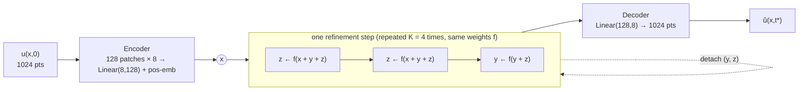
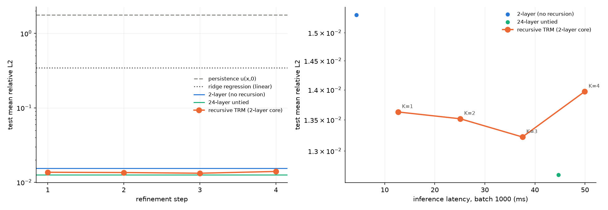
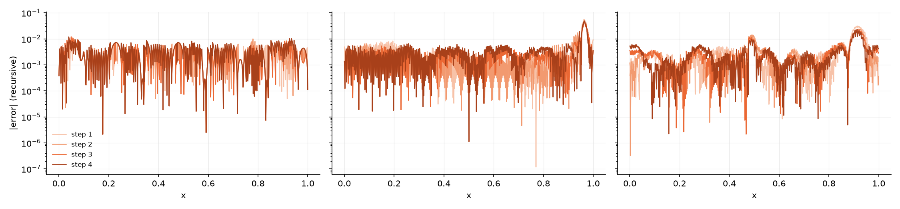
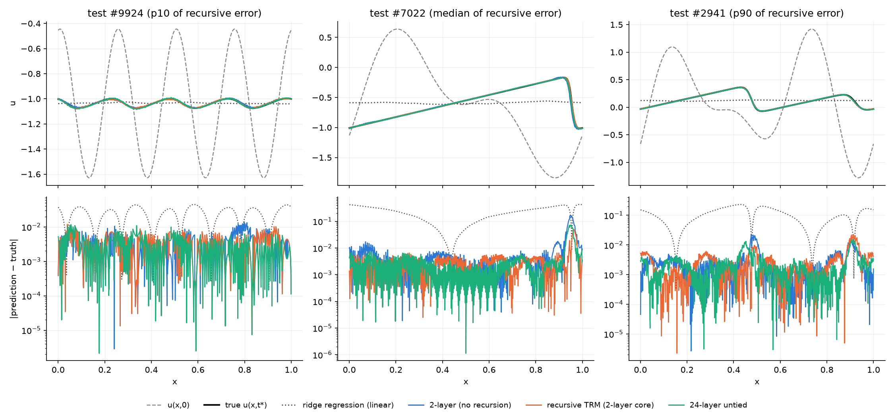

# Does thinking longer help a tiny network solve a PDE?

### TRM-style recursive refinement on PDEBench 1D Burgers, with controls for size and compute

> **Status.** All numbers below are from **seed 0**, which is complete: 3 models, test set evaluated.
> Seed 1, and a control that matches the number of optimizer updates, are still running. Places that will
> change are marked **[seed 1]**. Until seed 1 is in, treat differences of about 10% as unconfirmed.

**TL;DR.** A 2-layer Transformer applied recursively, 12 core calls per prediction, reaches **0.0140** test
relative L² on predicting u(x, t=1) from u(x, 0). That is **9% better** than the same network applied once
(0.0153), and **10% worse** than a 24-layer untied network that does the same computation (0.0126). The
recursive model has **11× fewer parameters** than the 24-layer one at about the same latency. On RMSE the
order changes: recursive is best (0.0075 vs 0.0149). Refinement steps 1→3 improve the prediction and step 4
makes it worse. Our conclusion: **recursion is parameter-efficient here, but on the primary metric it did not
beat spending the same computation on untied depth.** All three Transformers are about 25× better than the best
linear map, so the task is learnt and needs nonlinearity.

---

## 1. Motivation

### Why Burgers' equation?

The viscous Burgers equation

$$\partial_t u + \partial_x\!\left(\tfrac{u^2}{2}\right) = \tfrac{\nu}{\pi}\,\partial_{xx} u,\qquad x\in(0,1)\ \text{periodic}$$

is the simplest PDE that has both of the effects that make fluid dynamics hard:

* **Nonlinear advection** (u ∂ₓu): faster parts of the wave overtake slower parts, so smooth initial
  conditions **steepen into shocks**, i.e. near-discontinuities.
* **Diffusion** (ν ∂ₓₓu): smooths those fronts out, at a width set by ν.

It is the standard 1D model for gas dynamics, traffic flow and "Burgers turbulence", and the standard first test
for shock-capturing numerical schemes. For machine learning it is a useful stress test, because neural networks
are biased toward smooth, low-frequency functions, while Burgers solutions have **sharp, moving fronts whose
position depends nonlinearly on the whole initial condition**. A model that blurs or misplaces a shock gets a
large error. In 1D it is also cheap enough to run a controlled study with several models and seeds in one day
on two GPUs.

### Why recursion?

Classical PDE solvers are iterative: they take time steps, run Newton iterations, and do multigrid V-cycles. They
reach accuracy by **applying the same cheap update many times**, not by building a bigger operator. Recursive
neural models apply the same idea to learning: one small network is applied repeatedly to refine its own answer.

* **Tiny Recursive Models (TRM)** ([Jolicoeur-Martineau, 2025](https://arxiv.org/abs/2510.04871)) showed that a
  7M-parameter network that recursively refines a latent "reasoning" state z and an answer y reaches 45% on
  ARC-AGI-1. That beats far larger models, and "less is more" was the headline.
* Weight-tied depth has a long history: [Universal Transformers](https://arxiv.org/abs/1807.03819),
  [Deep Equilibrium Models](https://arxiv.org/abs/1909.01377), and in PDE learning
  [PDE-Refiner](https://arxiv.org/abs/2308.05732), which uses iterative refinement to fix the high-frequency
  errors of neural solvers.
* Recursion is attractive for scientific ML because it promises **solver-like accuracy from a parameter budget
  that fits on edge devices**, and **adjustable compute at inference time** (run more refinement steps when
  accuracy matters).

TRM's results come from **discrete puzzles with exact answers**, such as Sudoku, mazes and ARC. It is an open
question whether the same mechanism helps on a **continuous regression** problem with physical structure. That
is what we test, and we include the controls needed to separate "recursion helps" from "more compute helps".

### Why this dataset?

We use `1D_Burgers_Sols_Nu0.01.hdf5` from **PDEBench** ([Takamoto et al., NeurIPS 2022 Datasets & Benchmarks](https://arxiv.org/abs/2210.07182)):

| Reason | Detail |
|---|---|
| **A public, citable standard** | It has a fixed DOI ([doi:10.18419/darus-2986](https://doi.org/10.18419/darus-2986)), a fixed file, an MD5 checksum and published baselines, so anyone can rerun this study exactly. |
| **Large and high-resolution** | 10,000 trajectories × 1,024 grid points × 201 snapshots on t ∈ [0, 2]. That gives 8,000 training pairs, 8× the 1,000 used in the original FNO Burgers benchmark, and 1,000 test pairs, which keeps error bars tight. |
| **The right difficulty (ν = 0.01)** | PDEBench provides ν ∈ {0.001, 0.01, 0.1, 1.0}. The large-ν files are diffusion-dominated and smooth. ν = 0.001 is close to inviscid, with shocks thinner than the grid can resolve. At ν = 0.01 (effective viscosity ν/π ≈ 0.003) **shocks form but are still resolved at 1,024 points**, so the problem is genuinely nonlinear and still well-posed for a learnt model. Our ridge-regression baseline confirms the nonlinearity: the best linear map has 34% error. |
| **Fits the time budget** | One 8 GB file. The whole study (download, 3 models × 2 seeds, evaluation) fits in about 8 hours on 2×A100. |

The initial conditions are random superpositions of sine waves with random amplitudes and phases (PDEBench
Eq. 8), and boundaries are periodic.

---

## 2. Task and setup

**Task.** Learn the operator **u(x, 0) ↦ u(x, t\*)**, with t\* = 1.00. That is stored snapshot 100, midway
through the stored trajectory. We use one input/target pair per trajectory and all 1,024 grid points. Every
refinement step of the recursive model predicts the same t\*; the steps are *not* successive physical times.

| | |
|---|---|
| Split | 80/10/10 by trajectory (8,000 / 1,000 / 1,000), seed 42, made **before** any preprocessing |
| Normalization | One scalar mean and std (−0.0124, 0.7151) fitted on the training split only, then inverted before computing any metric |
| Metrics | **Mean per-trajectory relative L²**, ‖û − u‖₂ / ‖u‖₂ (primary), and RMSE in physical units |
| Selection | EMA weights (decay 0.999) chosen by best **validation** relative L². The test set is touched once, by `evaluate.py`. |
| Optimization | AdamW, lr 3·10⁻⁴, weight decay 0.01, gradient clipping 1.0, batch 64, BF16, 200-step warmup then cosine decay, **1,000 epochs for every model** |

### Models

All learned models share **the same patch encoder and decoder**. The 1,024-point field is cut into 128 patches of
8 points. A shared `Linear(8→128)` plus learned positional embeddings turns these into tokens, and a shared
`Linear(128→8)` turns tokens back into the field. The encoder and decoder are linear and act on each patch
separately, so **all mixing across space and all nonlinearity happen in the Transformer core**. The core is
made of pre-norm, non-causal Transformer layers (width 128, 4 heads, FFN ×4) with a final LayerNorm.



| Model | Core | Params | Layer applications per prediction | Role |
|---|---|---|---|---|
| **Recursive (TRM-style)** | 2 layers, reused: n = 2 z-updates + 1 y-update per step, K = 4 steps | 415,624 | 4 × 3 × 2 = **24** | the method being tested |
| Shallow | 2 layers, applied once | 415,368 | 2 | **same parameter count** as recursive |
| Deep | 24 untied layers, applied once | 4,777,352 | **24** | **same computation per prediction** as recursive |
| Ridge regression | linear map u(x,0) → u(x,t\*) with bias, α chosen on validation | 1,049,600 | – | does the task need nonlinearity? |
| Persistence | û = u(x,0) | 0 | – | does anything change over time? |
| Training-mean field | û = mean of the training targets | 1,024 | – | is the input used at all? |

**Recursive training follows TRM deep supervision.** For each of the 4 steps we:

1. re-encode the input with the current weights;
2. run the step's 3 core calls;
3. decode and take the MSE against the target;
4. back-propagate through those 3 calls and take an AdamW step;
5. detach (y, z) before the next step.

The learned initial y₀ and z₀ are vectors broadcast over all patches. This is a simplified, continuous-output TRM
(n = 2, T = 1, K = 4) with no learned halting.

---

## 3. Results

### 3.1 Main table (test set, n = 1,000)

| Model | Params | Layer apps | Val rel L² | **Test rel L²** | Test RMSE | Latency, batch 1 (ms) | Latency, batch 1000 (ms) | Train time (min) | Optimizer steps |
|---|---:|---:|---:|---:|---:|---:|---:|---:|---:|
| Training-mean field | 1,024 | – | 0.9999 | 1.0047 | 0.6026 | – | – | – | – |
| Persistence u(x,0) | 0 | – | – | 1.7669 | 0.5237 | – | – | – | – |
| Ridge regression | 1,049,600 | – | 0.3592 | 0.3434 | 0.1335 | – | – | – | – |
| Shallow (2-layer) | 415,368 | 2 | 0.01537 | 0.01533 | 0.00992 | **1.14** | **4.36** | **17.0** | 125k |
| **Recursive (TRM-style)** | 415,624 | 24 | 0.01370 | 0.01397 | **0.00752** | 8.66 | 49.94 | 141.5 | 500k |
| Deep (24-layer untied) | 4,777,352 | 24 | **0.01265** | **0.01263** | 0.01490 | 10.38 | 44.70 | 112.5 | 125k |

Seed 0 only. **[seed 1]** The final table will report mean ± std over 2 seeds. Latency is the median of 50
BF16 forward passes on an otherwise idle A100-SXM4-80GB.



*Left: test relative L² after each refinement step of the recursive model. The horizontal lines are the
baselines. Right: the same errors plotted against measured inference latency at batch 1000.*

### 3.2 Recursive model after each refinement step (same checkpoint)

| Step | Layer apps | Val rel L² | Test rel L² | Test RMSE | Latency, batch 1 (ms) | Latency, batch 1000 (ms) |
|---|---:|---:|---:|---:|---:|---:|
| 1 | 6 | 0.01346 | 0.01363 | 0.00849 | 2.51 | 12.67 |
| 2 | 12 | 0.01312 | 0.01352 | 0.00777 | 4.57 | 25.09 |
| 3 | 18 | **0.01299** | **0.01322** | **0.00747** | 6.62 | 37.51 |
| 4 (reported) | 24 | 0.01370 | 0.01397 | 0.00752 | 8.66 | 49.94 |



*|û − u| along x after each refinement step, for test trajectories at the 10th, 50th and 90th percentile of the
recursive model's error.*

### 3.3 Example predictions



*Top: u(x,0) (dashed), the true u(x,1) (black), and each model's prediction. Bottom: |error| on a log scale.
The three columns are the 10th, 50th and 90th percentile test trajectories by recursive-model error.*

<!-- TODO after viewing the figure: note where the errors concentrate (e.g. at the shock fronts). -->

### 3.4 Context: results from other work

**None of these numbers is directly comparable to ours.** The datasets and protocols differ, and the differences
are listed in the table. They are included to show the scale of error that strong methods reach on Burgers.

| Source | Data | Task | Model | Error |
|---|---|---|---|---|
| PDEBench, Table 7 ([Takamoto et al., 2022](https://arxiv.org/abs/2210.07182)) | **Same file** (ν = 0.01) | Autoregressive rollout of the whole trajectory from 10 initial steps, downsampled 4× in space (256 pts) and 5× in time | FNO | nRMSE **0.0078** |
| | | | U-Net | nRMSE 0.22 |
| | | | PINN (fitted per sample) | nRMSE 0.85 |
| FNO paper, Table 3 ([Li et al., ICLR 2021](https://arxiv.org/abs/2010.08895)) | Own dataset: ν = 0.1 (more diffusive), Gaussian random field initial conditions, **1,000** training samples | **Same task form**: u(x,0) ↦ u(x,1), relative L², at 1,024 points | FNO | **0.0160** |
| | | | LNO / MGNO / GNO | 0.0217 / 0.0374 / 0.0651 |
| | | | PCA-NN / FCN | 0.0391 / 0.1877 |
| **This study** | PDEBench ν = 0.01, 8,000 train | u(x,0) ↦ u(x,1), relative L², at 1,024 points | Shallow / Recursive / Deep Transformer | 0.0153 / 0.0140 / 0.0126 |

PDEBench's nRMSE, ‖û − u‖₂/‖u‖₂, has the same form as our metric, but there it is averaged over a rollout of
many steps, which accumulates error. Our Transformers fall in the same error range as FNO on the
same-form task, with more training data and a sharper-shock regime. We **did not** run FNO or U-Net on our
exact protocol. That comparison is the obvious next step, and the gap to PDEBench's FNO suggests that spectral
inductive biases remain strong on periodic 1D problems.

---

## 4. What the results say

1. **The task is learnt and needs nonlinearity.** The training-mean field scores 1.00, persistence 1.77 (the
   solution changes a lot by t = 1) and ridge regression 0.34. All three Transformers reach 0.013–0.015, which
   is **about 25× better than the best linear map**. The models are learning the nonlinear steepening, not just
   a linear filter.

2. **Recursion beats the same-size network, at a large cost.** Relative L² improves by 9% (0.0153 → 0.0140)
   and RMSE by 24%. The price is 7.6× the latency at batch 1, 8.3× the training time, and 4× the optimizer
   updates.

3. **Recursion does not beat untied depth at equal computation on the primary metric.** The 24-layer untied
   network reaches 0.0126, 10% better than the recursive model, at similar latency (10.4 vs 8.7 ms at batch 1).
   **The recursive model gets within about 10% of it with 11× fewer parameters.** That is the parameter-efficiency
   argument TRM makes, and in this setting it holds.

4. **The ranking depends on the metric.** On RMSE, recursive (0.0075) beats both shallow (0.0099) and deep
   (0.0149). Mean relative L² gives every trajectory equal weight, while RMSE is dominated by large-amplitude
   trajectories. The deep model's RMSE also moved a lot between validation (0.0138) and test (0.0149), so it is
   driven by a few trajectories and is noisy. **[seed 1]** will show whether the RMSE ordering holds.

5. **Refinement helps, then overshoots.** Error falls from step 1 to step 3 (0.0136 → 0.0132), then **rises
   at step 4 to 0.0140**, which is worse than step 1. The same pattern appears on validation and test, and in
   the overfitting sanity run. Step 3 (18 layer applications) comes within about 5% of the deep model at 64% of
   its latency. Because the protocol fixed step 4 as the reported output before training, we report step 4
   and treat step 3 as an exploratory observation, not a tuned result.

6. **Most of the gain arrives within the first step.** Step 1 already beats the shallow model (0.0136 vs
   0.0153). One step is 3 core calls, i.e. 6 layer applications, against shallow's 2, and its weights received
   4× the optimizer updates. Repeated refinement (steps 2–4) adds little on top.
   **[control]** A shallow model trained for 4,000 epochs (500k updates, the same as recursive) is running. If
   it closes the gap, the advantage over shallow comes from extra updates, not from depth or recursion.

### Verdict

On this problem, **TRM-style recursion is a parameter-efficient way to buy depth, but it is not a better use of
compute than ordinary depth.** We do not claim recursion helps. It beats the same-size control, but it does not
beat the same-compute control on relative L², and its last refinement step hurts. **[seed 1]** may tighten or
overturn the gaps of about 10%.

---

## 5. Limitations

* **Seeds.** Seed 0 only so far. Seed 1 is running for all three models. Two seeds give a rough spread, not
  confidence intervals.
* **Unequal training compute is part of the design.** With equal epochs, the recursive model makes 4× the
  optimizer updates and runs 12× the core calls per batch. The 4× update control addresses the first point for
  the shallow model only.
* **A single configuration.** One viscosity, one target time, one train size, and n = 2, K = 4 fixed in
  advance. There was no hyperparameter search for any model, and one learning-rate schedule was shared by
  all, which may suit some models better than others.
* **Instability.** The recursive model showed transient validation spikes during training (e.g. 0.05 → 0.11 →
  0.06 in the overfitting run, and several smaller ones in the full run). Checkpoint selection on validation hides this from the final numbers, but it
  suggests that 4 updates per batch at lr 3·10⁻⁴ is aggressive.
* **No spectral or convolutional baseline** on our exact protocol (FNO or U-Net), so we cannot place these
  Transformers against the state of the art. The table in §3.4 is context only.
* **Time indexing.** PDEBench stores 202 time values for 201 snapshots. We assume snapshot k is at t[k], which
  gives t\* = 1.00. Under the other reading t\* = 1.01. The choice is logged in `data/burgers_nu0.01_t1_meta.json`.
* **Latency is overhead-bound.** These models are tiny (GPU utilization was about 25%), so latency tracks the
  number of sequential layer calls, not FLOPs. The relative costs would differ for larger models or with CUDA
  graphs.

## 6. Next steps

1. Report 2–3 seeds per model (in progress), and the update-matched control.
2. Run FNO and U-Net under exactly this protocol.
3. Test whether the step-4 overshoot is fixable: weight later steps' losses more heavily, use a lower learning
   rate for the recursive model, or select the best step on validation as part of the method.
4. Make the computation adaptive: run more refinement steps on hard trajectories (those with shocks), as in TRM's
   learned halting.
5. Sweep viscosity (ν = 0.001 → 1.0) and target time to see whether recursion helps more when shocks are sharper.

---

## Reproduce

Commands, configuration and outputs are in [`README.md`](README.md). The short version, on 2 GPUs:

```bash
conda env create -f pde_burgers/environment.yml && conda activate trm-burgers
bash pde_burgers/run_server.sh data      # download, verify MD5, preprocess
EPOCHS_RECURSIVE=1000 EPOCHS_SHALLOW=1000 EPOCHS_DEEP=1000 bash pde_burgers/run_server.sh train
bash pde_burgers/run_server.sh eval      # results/results.md, metrics.json, figures
```

## Acknowledgements and references

Built on **Tiny Recursive Models** by Alexia Jolicoeur-Martineau, Samsung SAIL Montréal
([paper](https://arxiv.org/abs/2510.04871), [code](https://github.com/SamsungSAILMontreal/TinyRecursiveModels), MIT License).

* Takamoto et al., *PDEBench: An Extensive Benchmark for Scientific Machine Learning*, NeurIPS 2022 Datasets & Benchmarks. [arXiv:2210.07182](https://arxiv.org/abs/2210.07182)
* Li et al., *Fourier Neural Operator for Parametric Partial Differential Equations*, ICLR 2021. [arXiv:2010.08895](https://arxiv.org/abs/2010.08895)
* Jolicoeur-Martineau, *Less is More: Recursive Reasoning with Tiny Networks*, 2025. [arXiv:2510.04871](https://arxiv.org/abs/2510.04871)
* Lippe et al., *PDE-Refiner: Achieving Accurate Long Rollouts with Neural PDE Solvers*, NeurIPS 2023. [arXiv:2308.05732](https://arxiv.org/abs/2308.05732)
* Dehghani et al., *Universal Transformers*, ICLR 2019. [arXiv:1807.03819](https://arxiv.org/abs/1807.03819)
* Bai, Kolter & Koltun, *Deep Equilibrium Models*, NeurIPS 2019. [arXiv:1909.01377](https://arxiv.org/abs/1909.01377)
